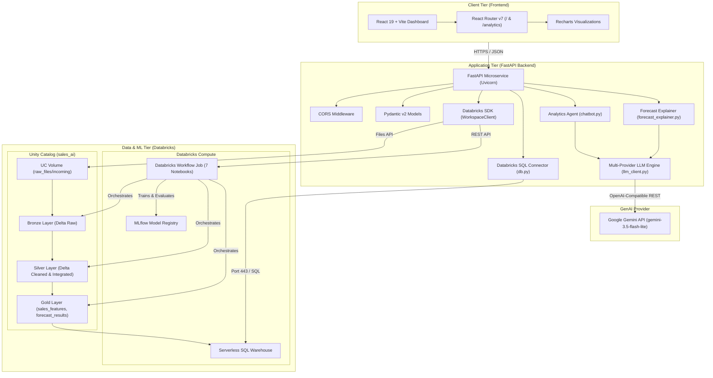

# Sales AI — Retail Sales Forecasting & GenAI Decision Support Platform

[](https://python.org)
[](https://fastapi.tiangolo.com)
[](https://react.dev)
[](https://vitejs.dev)
[](https://databricks.com)
[](https://aistudio.google.com)
[](https://lightgbm.readthedocs.io)
[](LICENSE)

An enterprise-grade, full-stack retail intelligence platform that unifies cloud lakehouse data pipelines, gradient-boosted time-series forecasting, and large language model (LLM) decision support. The platform couples a 7-stage Databricks Medallion architecture with a high-performance FastAPI microservice and an interactive React 19 executive dashboard.

---

## Table of Contents

1. [Project Overview](#project-overview)
2. [Problem Statement](#problem-statement)
3. [Key Features](#key-features)
4. [Application Screenshots](#application-screenshots)
5. [System Architecture](#system-architecture)
6. [Technology Stack](#technology-stack)
7. [Medallion Data Pipeline](#medallion-data-pipeline)
8. [Machine Learning Pipeline](#machine-learning-pipeline)
9. [Generative AI Decision Support](#generative-ai-decision-support)
10. [Databricks Lakehouse Integration](#databricks-lakehouse-integration)
11. [Repository Structure](#repository-structure)
12. [Local Installation and Setup](#local-installation-and-setup)
13. [Environment Variables Reference](#environment-variables-reference)
14. [Backend API Documentation](#backend-api-documentation)
15. [Production Deployment Guide](#production-deployment-guide)
16. [Testing Instructions](#testing-instructions)
17. [Future Roadmap](#future-roadmap)
18. [License](#license)

---

## Project Overview

**Sales AI** bridges the operational gap between machine learning forecasting workflows and retail executive decision-making. Traditional demand planning workflows frequently suffer from fragmented architectures: forecasting models output static spreadsheets, analytical aggregations require slow ad-hoc SQL queries, and demand planners lack grounded qualitative explanations for why demand spikes or collapses.

Sales AI solves this by delivering:
- An automated **Databricks Unity Catalog Lakehouse** (Bronze &rarr; Silver &rarr; Gold) for data ingestion and feature generation.
- A Champion **LightGBM 30-day recursive time-series forecasting** model registered and tracked via MLflow.
- A **FastAPI microservice** offering parameterized SQL queries over a Databricks Serverless SQL Warehouse.
- A **Google Gemini GenAI Copilot** providing grounded forecast explanations (JSON mode) and conversational analytics (tool calling against live SQL queries).
- A modern **React 19 + TypeScript + Vite** executive interface.

---

## Problem Statement

Retail inventory management balances two costly operational risks:
1. **Stockouts (Under-forecasting):** Missed revenue, customer dissatisfaction, and brand churn.
2. **Overstock (Over-forecasting):** High working capital lockup, warehousing overhead, and forced markdowns.

Most retail teams lack a unified platform that connects raw transactional logs with automated model retraining, visual forecast confidence intervals, and conversational analytics. Sales AI addresses this by providing automated ingestion, ML-driven unit predictions, and natural language explanations of demand drivers.

---

## Key Features

- **30-Day Recursive Multi-Step Forecasts:** Generates daily predicted unit demand per product-store series with horizon tracking from $t+1$ to $t+30$.
- **Unified Actuals vs. Predictions Timeline:** Seamlessly joins 90-day historical actuals from `sales_features` with upcoming forecast curves on continuous Recharts graphs.
- **Hallucination-Free GenAI Forecast Explanations:** Utilizes Google Gemini (`gemini-3.5-flash-lite`) in strict JSON mode with prompt guardrails to translate demand volatility, price elasticity, and calendar events into structured business narratives.
- **Conversational Analytics Copilot:** ReAct-style tool calling queries live Databricks SQL aggregates for category rankings, product sales, and store benchmarks.
- **Executive KPI Monitoring:** Real-time visibility into top categories, leading revenue products, total predicted units, and at-risk products exhibiting month-over-month decline.
- **Automated Data Ingestion & Job Orchestration:** Upload incremental transaction CSVs directly to Unity Catalog Volumes and trigger Databricks Workflow runs from the frontend.

---

## Application Screenshots

### Executive Dashboard Overview


### Forecast Trend & Historical Actuals

*Figure: Unified Recharts visualization displaying historical actual sales and LightGBM predicted unit demand.*

### GenAI Narrative Explanation Panel
> *(Screenshot Placeholder: `images/explanation_panel.png` — Visualizing structured key drivers, demand volatility risks, and inventory recommendations).*

### Conversational Analytics Copilot
> *(Screenshot Placeholder: `images/analytics_chat.png` — Natural language querying with live tool execution against Databricks).*

---

## System Architecture



---

## Technology Stack

| Layer | Component | Technologies |
|---|---|---|
| **Frontend** | Framework & Language | React 19, TypeScript, Vite 8 |
| | UI & Visualization | Recharts, Custom CSS Modules, Responsive App Shell |
| | Routing & State | React Router v7, Axios, Custom React Hooks (`useCountUp`) |
| | Code Quality | Oxlint, TypeScript Compiler (`tsc`) |
| **Backend** | Framework | FastAPI, Starlette, Uvicorn (ASGI) |
| | Validation & Config | Pydantic v2, Python-Dotenv |
| | Connectors & SDKs | `databricks-sql-connector`, `databricks-sdk`, `openai` |
| | Data Processing | Pandas, PyArrow, NumPy |
| | Test Suite | Pytest, AnyIO, Unittest Mock |
| **Data Lakehouse** | Storage & Governance | Databricks Unity Catalog, Delta Lake, UC Volumes |
| | Query Engine | Databricks Serverless SQL Warehouse |
| | Orchestration | Databricks Workflows / Jobs API (Multi-task DAG) |
| **Machine Learning** | Frameworks | LightGBM, Scikit-learn, XGBoost |
| | Lifecycle Tracking | MLflow (Metrics, Parameters, Model Artifacts) |
| **Generative AI** | Model & Inference | Google Gemini (`gemini-3.5-flash-lite`), OpenAI API Compatibility |
| | Architecture | Function Calling (Tool Calling), Structured JSON Mode |
| **Hosting & DevOps** | Production Infrastructure | Render (Backend Web Service), Vercel (Frontend Global CDN) |
| | Containers & Tools | Docker, Dockerfile, Git, Astral `uv` |

---

## Medallion Data Pipeline

The project follows Databricks' multi-layer Medallion architecture within the `sales_ai` catalog:

```
[Raw CSVs in UC Volume] 
       │
       ▼
┌──────────────┐
│ Bronze Layer │  02_bronze_ingestion.py
│ (sales_raw)  │  Delta tables preserving append-only raw ingestion
└──────┬───────┘
       │
       ▼
┌──────────────┐
│ Silver Layer │  03_silver_transformation.py
│ (integrated) │  Deduplication, timestamp casting, joins (products + stores)
└──────┬───────┘
       │
       ▼
┌──────────────┐
│  Gold Layer  │  05_gold_transformation.py
│(features &   │  Lag creation, rolling stats, 30-day forecast outputs
│ predictions) │
└──────────────┘
```

### 1. Bronze Layer (`sales_ai.bronze`)
- **Ingestion:** Reads CSV transactions, store metadata, product listings, and external marketing calendars from Unity Catalog Volumes (`/Volumes/sales_ai/bronze/raw_files/`).
- **Tables:** `sales_raw`, `calendar_raw`, `products_raw`, `stores_raw`.
- **Characteristics:** Schema enforcement with raw data preservation.

### 2. Silver Layer (`sales_ai.silver`)
- **Transformation:** Date normalization, null imputation, duplicate elimination, category standardization, and referential integrity checks.
- **Tables:** 
  - `products`: Product dimension (`product_id`, `product_name`, `category`, `base_price`).
  - `stores`: Store dimension (`store_id`, `store_name`, `city`, `region`).
  - `sales_cleaned`: Validated transactional sales.
  - `calendar_cleaned`: Calendar dates enriched with holiday tags and promotional event flags.
  - `sales_integrated`: Fully denormalized transactional history joined with product and store attributes (82,500+ rows).

### 3. Gold Layer (`sales_ai.gold`)
- **Feature Engineering:** Computes time-series lag features (7, 14, 28 days), rolling aggregates (7, 14, 28-day rolling means and standard deviations), price elasticity tiers, exponential moving averages, and month-over-month (MoM) growth rates.
- **Tables:**
  - `sales_features`: Feature store table powering ML training and historical dashboard lookups (87,600+ rows).
  - `forecast_results`: Model inference output containing 30-day forward predictions per series (1,440 rows).
  - `model_evaluation_results`: Out-of-sample backtest scores and residual distributions (35,000+ rows).

---

## Machine Learning Pipeline

### 1. Model Architecture
- **Algorithm:** LightGBM (`LGBMRegressor`) Gradient Boosted Decision Tree.
- **Objective:** Regression with Root Mean Squared Error (`RMSE`) loss.
- **Features Fed to Model:**
  - Lags: `lag_7`, `lag_14`, `lag_28`
  - Rolling Statistics: `rolling_mean_7`, `rolling_mean_14`, `rolling_mean_28`, `rolling_std_7`
  - Calendar Features: `day_of_week`, `day_of_month`, `month`, `is_weekend`, `holiday_flag`
  - Promotional Flags: `promotion_flag`, `discount_depth`
  - Price Features: `unit_price`, `price_ratio_to_base`

### 2. Training & MLflow Tracking (`06_model_training.py`)
- **Validation Strategy:** Temporal train/test split to prevent data leakage.
- **Evaluation Metrics:**
  - **RMSE:** Measures absolute magnitude of forecast errors.
  - **MAE:** Mean absolute error reflecting expected unit deviation.
  - **WAPE:** Weighted Absolute Percentage Error providing scale-independent retail accuracy.
- **MLflow Tracking:** All runs log hyperparameter settings, training curves, feature importance charts, and the registered champion model `sales_ai.gold.sales_forecasting_lgbm`.

### 3. 30-Day Recursive Batch Inference (`07_batch_inference.py`)
Because future lagged sales values are not available at forecast time, the inference pipeline executes a **recursive multi-step forecasting loop**:
1. Predict demand for horizon $t+1$.
2. Feed predicted units back into the dynamic feature matrix to update lags and rolling means for $t+2$.
3. Repeat recursively through day $t+30$.
4. Write enriched predictions into `sales_ai.gold.forecast_results`.

---

## Generative AI Decision Support

### Multi-Provider Architecture (`backend/src/genai/llm_client.py`)
The backend features an adaptive client supporting three providers in prioritized order:
1. **Google Gemini API (Default / Recommended):** Uses `gemini-3.5-flash-lite` via Google's OpenAI-compatible REST endpoint (`https://generativelanguage.googleapis.com/v1beta/openai/`).
2. **OpenAI Direct API:** Optional fallback using standard models (e.g. `gpt-4o-mini`).
3. **Azure OpenAI Service:** Enterprise deployment compatibility.

### 1. Hallucination-Free Forecast Explanations (`forecast_explainer.py`)
- **Context Injection:** Extracts product lifecycle stage, demand class, price elasticity tier, upcoming holidays, and historical vs. forecasted unit variations into a structured context object (`explain_context.py`).
- **Strict JSON Mode:** Requests JSON formatting and validates response keys:
  ```json
  {
    "explanation": "Plain language summary of demand trajectory",
    "key_drivers": ["Growing lifecycle", "High elasticity tier", "Upcoming holiday"],
    "risks_or_opportunities": ["Volatility alert", "Stockout exposure"],
    "recommendation": "Prescriptive replenishment instruction"
  }
  ```
- **Numeric Grounding Guardrails:** Scans LLM text output against numbers present in the injected database context to identify and suppress hallucinated statistics.

### 2. Conversational Analytics Copilot (`chatbot.py`)
- **ReAct Tool-Calling:** Exposes three analytics functions to the LLM:
  - `get_top_category(days, store_id)`
  - `get_top_product(days, store_id)`
  - `compare_categories(category_a, category_b)`
- **Execution Flow:**
  1. User asks a natural language business question.
  2. Gemini decides which SQL tool and parameters are required.
  3. Backend executes parameterized queries against Databricks SQL Warehouse.
  4. Tool results are supplied back to Gemini to synthesize a natural-language answer.

---

## Databricks Lakehouse Integration

The platform interacts with Databricks across two distinct interfaces:

1. **Databricks SQL Warehouse (Data Serving):**
   - Utilizes `databricks-sql-connector` with Personal Access Token (PAT) authentication.
   - Executes fast parameterized queries on Gold tables to power dashboard charts and KPI cards.
2. **Databricks REST API (Pipelines & Ingestion):**
   - Utilizes `databricks-sdk` (`WorkspaceClient`).
   - Powers `POST /pipeline/upload` (direct streaming of raw CSVs into Unity Catalog Volumes).
   - Powers `POST /pipeline/trigger` (programmatic execution of the 7-notebook Databricks Workflow Job).

---

## Repository Structure

```
sales_ai_project/
├── backend/                              # FastAPI Microservice
│   ├── src/
│   │   ├── data/
│   │   │   ├── analytics.py              # KPI calculation & tool functions
│   │   │   ├── databricks_client.py      # Databricks SQL connector manager
│   │   │   ├── databricks_jobs.py        # Databricks SDK Jobs & Volumes integration
│   │   │   ├── db.py                     # Parameterized SQL queries for Gold layer
│   │   │   ├── forecast_results_loader.py# Offline fallback loader
│   │   │   └── test_connection.py        # Connection verification utility
│   │   ├── genai/
│   │   │   ├── chatbot.py                # ReAct tool-calling agent
│   │   │   ├── explain_context.py        # Feature & demand context builder
│   │   │   ├── forecast_explainer.py     # JSON-mode narrative generator
│   │   │   └── llm_client.py             # Multi-provider client (Gemini/OpenAI/Azure)
│   │   └── models/
│   │       └── schemas.py                # Pydantic v2 request/response schemas
│   ├── tests/                            # Pytest unit tests (35 test cases)
│   │   ├── test_analytics.py
│   │   ├── test_api_endpoints.py
│   │   ├── test_explain_context.py
│   │   ├── test_llm_client.py
│   │   └── test_schemas.py
│   ├── Dockerfile                        # Container specification
│   ├── main.py                           # Application entrypoint & routes
│   └── requirements.txt                  # Production runtime dependencies
├── Databricks/
│   └── Sales_ai/                         # Databricks Asset Bundle (DAB) & Notebooks
│       ├── resources/
│       │   └── sales_ai.job.yml          # Workflow DAG definition
│       └── src/
│           ├── 01_setup_sales_ai.py      # Catalog & schema initialization
│           ├── 02_bronze_ingestion.py    # Raw CSV to Delta Bronze
│           ├── 03_silver_transformation.py# Cleansing & silver denormalization
│           ├── 04_exploratory_data_analysis.py # EDA & statistics
│           ├── 05_gold_transformation.py # Feature engineering (lags, rolling stats)
│           ├── 06_model_training.py      # LightGBM training & MLflow logging
│           └── 07_batch_inference.py     # 30-day recursive forecast generation
├── frontend/                             # React 19 Executive UI
│   ├── public/                           # Static icons & SVGs
│   ├── src/
│   │   ├── api/                          # Axios API service client
│   │   ├── components/                   # React components (Charts, Panels, Layout)
│   │   ├── pages/                        # Dashboard & Analytics views
│   │   ├── App.tsx                       # React Router configuration
│   │   └── main.tsx                      # Vite React entrypoint
│   ├── package.json                      # Frontend dependencies
│   ├── vercel.json                       # Vercel SPA rewrite routing rules
│   └── vite.config.ts                    # Vite configuration
├── data/                                 # Initial training & incremental CSV datasets
├── render.yaml                           # Render Blueprint Infrastructure-as-Code
└── README.md                             # Project documentation
```

---

## Local Installation and Setup

### Prerequisites
- **Python:** 3.12+
- **Node.js:** 20+ and npm 10+
- **Databricks Workspace:** Unity Catalog enabled with a running SQL Warehouse.
- **Google Gemini API Key:** Free key from [Google AI Studio](https://aistudio.google.com/apikey).

### 1. Clone the Repository
```bash
git clone https://github.com/ANURAGVIVEK0919/sales.ai.git
cd sales.ai
```

### 2. Backend Setup
```bash
# Navigate to backend directory
cd backend

# Create and activate virtual environment
python -m venv .venv
# On Windows:
.venv\Scripts\activate
# On Linux/macOS:
source .venv/bin/activate

# Install dependencies
pip install -r requirements.txt

# Configure environment variables (see below)
cp .env.example .env
```

### 3. Frontend Setup
```bash
# Navigate to frontend directory
cd ../frontend

# Install npm packages
npm install

# Configure environment variables
cp .env.example .env
```

### 4. Running the Development Servers

**Start Backend (Terminal 1):**
```bash
cd backend
uvicorn main:app --host 127.0.0.1 --port 8000 --reload
```
*API available at: `http://127.0.0.1:8000` | Swagger docs at: `http://127.0.0.1:8000/docs`*

**Start Frontend (Terminal 2):**
```bash
cd frontend
npm run dev
```
*UI available at: `http://localhost:5173`*

---

## Environment Variables Reference

Create a `.env` file in `backend/` using this safe template:

```ini
# ==============================================================================
# Databricks SQL Warehouse (PAT auth)
# ==============================================================================
DATABRICKS_SERVER_HOSTNAME=your-workspace.cloud.databricks.com
DATABRICKS_HTTP_PATH=/sql/1.0/warehouses/your-warehouse-id
DATABRICKS_TOKEN=dapiXXXXXXXXXXXXXXXXXXXXXXXXXXXXXXXX

# ==============================================================================
# Databricks Jobs & Unity Catalog Volumes
# ==============================================================================
DATABRICKS_HOST=https://your-workspace.cloud.databricks.com
DATABRICKS_JOB_ID=your-job-id
DATABRICKS_VOLUME_INCOMING_PATH=/Volumes/sales_ai/bronze/raw_files/incoming

# ==============================================================================
# Generative AI Provider (Google Gemini)
# ==============================================================================
GEMINI_API_KEY=AIzaSyXXXXXXXXXXXXXXXXXXXXXXXXXXXXXX
GEMINI_MODEL=gemini-3.5-flash-lite

# ==============================================================================
# CORS Configuration
# ==============================================================================
ALLOWED_ORIGINS=http://localhost:5173,https://your-app.vercel.app
```

Create a `.env` file in `frontend/`:

```ini
VITE_API_BASE_URL=http://localhost:8000
```

---

## Backend API Documentation

Interactive Swagger documentation is automatically generated at `/docs`.

| Method | Endpoint | Description |
|---|---|---|
| `GET` | `/health` | Verifies service health and Databricks SQL Warehouse connectivity. |
| `GET` | `/products` | Retrieves list of distinct products (`product_id`, `product_name`, `category`). |
| `GET` | `/stores` | Retrieves store catalog with regional attributes. |
| `GET` | `/kpis` | Computes executive summary metrics (top category, top product, predicted revenue, at-risk count). |
| `GET` | `/forecast` | Returns flat forecast records, or unified history + predictions when `include_history=true`. |
| `GET` | `/forecast/trend/all` | Returns all forecasted records grouped by product ID. |
| `POST` | `/forecast/explain` | Generates a structured narrative explanation for a forecast series using Google Gemini. |
| `POST` | `/chat` | Conversational analytics assistant using function calling over Databricks SQL. |
| `POST` | `/chat/quick` | Executes deterministic quick-action insight buttons without LLM latency. |
| `POST` | `/pipeline/upload` | Streams raw sales/calendar CSVs directly into Databricks UC Volumes. |
| `POST` | `/pipeline/trigger` | Triggers immediate execution of the Databricks retraining Workflow Job. |
| `GET` | `/pipeline/status/{run_id}` | Polls lifecycle status (`RUNNING`, `TERMINATED`, `SUCCESS`) of a Databricks Job run. |

---

## Production Deployment Guide

### Backend Deployment (Render)
1. Link your GitHub repository in the **Render Dashboard**.
2. Create a new **Web Service** with the following settings:
   - **Root Directory:** `backend`
   - **Environment:** `Python 3`
   - **Build Command:** `pip install -r requirements.txt`
   - **Start Command:** `uvicorn main:app --host 0.0.0.0 --port $PORT`
   - **Health Check Path:** `/health`
3. Add the environment variables from the [Environment Variables Reference](#environment-variables-reference).
4. Once deployed, note your Render backend URL (e.g. `https://sales-ai-backend.onrender.com`).

### Frontend Deployment (Vercel)
1. Import your GitHub repository in the **Vercel Dashboard**.
2. Configure project settings:
   - **Framework Preset:** `Vite`
   - **Root Directory:** `frontend`
   - **Build Command:** `npm run build`
   - **Output Directory:** `dist`
3. Add the environment variable:
   - `VITE_API_BASE_URL` = `https://<your-backend-name>.onrender.com`
4. The included `frontend/vercel.json` ensures client-side routing on `/analytics` works across browser refreshes.
5. In Render, update `ALLOWED_ORIGINS` to include your new Vercel domain.

---

## Testing Instructions

### Backend Unit Tests
Execute the comprehensive Pytest suite covering analytics calculations, Pydantic schemas, API route mocks, and multi-provider LLM failovers:

```bash
cd backend
pytest -v
```

**Results:**
```text
collected 35 items
backend/tests/test_analytics.py ............ [ 17%]
backend/tests/test_api_endpoints.py ......... [ 60%]
backend/tests/test_explain_context.py ...... [ 65%]
backend/tests/test_llm_client.py ........... [ 85%]
backend/tests/test_schemas.py .............. [100%]
============================== 35 passed in 2.36s ==============================
```

### Frontend Linting & Production Build
Validate TypeScript types and build minified production bundles:

```bash
cd frontend
# Run linter
npm run lint

# Run typecheck & build
npm run build
```

---

## Future Roadmap

- [ ] **Multi-Model Ensembling:** Combine LightGBM with NeuralProphet and XGBoost models.
- [ ] **Store Hierarchy Rollups:** Implement regional and district-level automated aggregations.
- [ ] **Real-Time Streaming:** Integrate Databricks Delta Live Tables (DLT) with streaming Kafka / Event Hub ingestion.
- [ ] **Automated Alerts:** Slack/Email webhook notifications when a product's demand volatility exceeds 25%.

---

## License

This project is licensed under the MIT License — see the [LICENSE](LICENSE) file for details.
