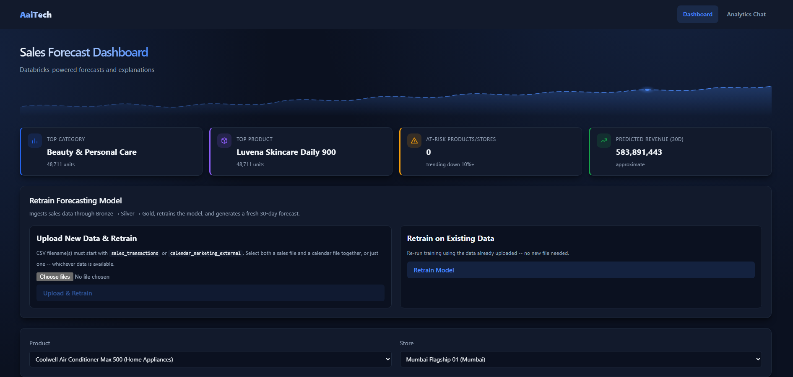

# Sales AI — Retail Sales Forecasting & GenAI Decision Support Platform

An enterprise-grade, end-to-end AI platform for retail sales forecasting, historical actuals tracking, automated pipeline orchestration, and GenAI-powered decision support.



---

## Table of Contents

1. [Overview & Main Features](#overview--main-features)
2. [Technology Stack](#technology-stack)
3. [Project Architecture](#project-architecture)
4. [Folder Structure](#folder-structure)
5. [Prerequisites](#prerequisites)
6. [Installation & Setup](#installation--setup)
7. [Environment Variables Configuration](#environment-variables-configuration)
8. [Database & Data Platform Setup](#database--data-platform-setup)
9. [External API & GenAI Configuration](#external-api--genai-configuration)
10. [Running the Application](#running-the-application)
11. [API Endpoints Reference](#api-endpoints-reference)
12. [Testing](#testing)
13. [Troubleshooting Guide](#troubleshooting-guide)
14. [Known Limitations](#known-limitations)
15. [Future Improvements](#future-improvements)

---

## Overview & Main Features

**Sales AI** bridges the gap between machine learning operations and retail business decision-makers. It unifies predictive models, medallion data pipelines, and large language models into an interactive dashboard and conversational copilot.

### Core Capabilities:
- **30-Day Recursive Sales Forecasting:** Generates day-by-day unit forecasts per product-store series using a Champion LightGBM gradient-boosted tree model.
- **Unified Actuals vs. Predicted Trends:** Merges historical observations from the gold features table with future predictions on a continuous timeline.
- **GenAI Forecast Explanations:** Employs Azure OpenAI in JSON mode with rigorous prompt guardrails to translate statistical trends, seasonality, price elasticity, and promotional history into actionable business narratives.
- **Analytics Chat & Quick Insights:** Conversational interface with tool-calling capabilities that computes answers exclusively from verified SQL aggregates—preventing hallucinations.
- **Automated Data Ingestion & Pipeline Orchestration:** Direct integration with Databricks Unity Catalog Volumes and Jobs API to upload incremental transactions and trigger medallion retraining jobs.
- **Executive KPI Monitoring:** Real-time visibility into top-performing categories, leading revenue products, and at-risk products exhibiting month-over-month decline.

---

## Technology Stack

| Layer | Technologies |
|---|---|
| **Frontend** | React 19, TypeScript, Vite 8, React Router v7, Recharts, Axios, React Markdown, Oxlint |
| **Backend** | Python 3.12, FastAPI, Uvicorn, Pydantic v2, Python-Dotenv, Pytest |
| **Data & Cloud** | Databricks Unity Catalog, Databricks SQL Warehouse, Databricks SDK, PyArrow, Pandas |
| **Machine Learning** | MLflow, LightGBM, Scikit-learn, XGBoost |
| **Generative AI** | Multi-provider support: Google Gemini API (gemini-2.0-flash / gemini-1.5-flash), OpenAI (GPT-4o / GPT-4o-mini), or Azure OpenAI Service (with Function Calling & JSON mode) |
| **DevOps & Containers** | Docker, Docker Compose, Azure Container Apps / Azure Container Registry (ACR), uv package manager |

---

## Project Architecture

```
                                  +---------------------------------------+
                                  |         React 19 + Vite UI            |
                                  |  (Dashboard, Charts, Chat, Pipelines) |
                                  +-------------------+-------------------+
                                                      |
                                                      | HTTP / JSON (CORS)
                                                      v
                                  +---------------------------------------+
                                  |            FastAPI Backend            |
                                  |  - Query Parameterization & Schema    |
                                  |  - Prompt Guardrails & Tool Calling   |
                                  +---------+-------------------+---------+
                                            |                   |
                        Databricks SQL / PAT|                   | Azure OpenAI API
                                            v                   v
+---------------------------------------------+   +-------------------------------+
|           Databricks Unity Catalog          |   |      Azure OpenAI Service     |
| - sales_ai.silver.products / stores         |   | - JSON-mode Explanations      |
| - sales_ai.gold.sales_features              |   | - Tool-Calling Chatbot        |
| - sales_ai.gold.forecast_results            |   +-------------------------------+
| - Unity Catalog Volume (raw_files)          |
| - Databricks Workflow Jobs                  |
+---------------------------------------------+
```

---

## Folder Structure

```
sales_ai_project/
├── backend/                              # FastAPI Microservice
│   ├── src/
│   │   ├── data/
│   │   │   ├── analytics.py              # Business analytics queries & KPI aggregations
│   │   │   ├── databricks_client.py      # Databricks SQL Warehouse connection manager
│   │   │   ├── databricks_jobs.py        # UC Volumes upload & Jobs run trigger
│   │   │   ├── db.py                     # Parameterized SQL queries for Gold/Silver tables
│   │   │   ├── forecast_results_loader.py# Forecast results loader with local CSV/Parquet fallback
│   │   │   └── test_connection.py        # Connection verification utility
│   │   ├── genai/
│   │   │   ├── chatbot.py                # Tool-calling agent for conversational queries
│   │   │   ├── explain_context.py        # Context builder (computed facts only)
│   │   │   ├── forecast_explainer.py     # Prompt formatting & JSON guardrails
│   │   │   └── llm_client.py             # Azure OpenAI client configuration
│   │   └── models/
│   │       └── schemas.py                # Pydantic request & response schemas
│   ├── tests/                            # Automated Pytest suite
│   │   ├── test_analytics.py
│   │   ├── test_api_endpoints.py
│   │   ├── test_explain_context.py
│   │   └── test_schemas.py
│   ├── .env.example                      # Backend environment variable template
│   ├── Dockerfile                        # Backend container specification
│   ├── main.py                           # Application entry point & route definitions
│   ├── pyproject.toml                    # UV / Python dependencies configuration
│   └── requirements.txt                  # Production pip requirements
│
├── frontend/                             # React + Vite Frontend Application
│   ├── src/
│   │   ├── api/                          # Axios client & typed endpoint wrappers
│   │   ├── components/                   # UI components (KPIBar, ForecastChart, ChatPanel, etc.)
│   │   ├── pages/                        # DashboardPage, AnalyticsChatPage
│   │   ├── App.tsx                       # React Router configuration
│   │   └── main.tsx                      # Frontend mount point
│   ├── .env.example                      # Frontend environment variable template
│   ├── package.json                      # NPM package manifest
│   ├── tsconfig.json                     # TypeScript compiler configuration
│   └── vite.config.ts                    # Vite build configuration
│
├── data/                                 # Raw training data & update batches
│   ├── Initial-Training-Data/            # Products, stores, sales transactions, calendar CSVs
│   └── Jan-March-2026/                   # Monthly incremental transaction batches
│
├── Databricks/Sales_ai/                  # Databricks Asset Bundle (DAB) & Notebooks
│   ├── src/                              # Medallion notebooks (Bronze -> Silver -> Gold -> Train -> Infer)
│   ├── resources/                        # Job YAML workflow definition
│   └── databricks.yml                    # Databricks bundle configuration
│
├── .gitignore                            # Root version control exclusions
├── DABS-GUIDE.md                         # Databricks Asset Bundle deployment guide
├── DOCKER_BUILD_AND_PUSH_TO_ACR.md       # Azure Container Registry deployment guide
├── pyproject.toml                        # Root project definition
└── README.md                             # Comprehensive project documentation
```

---

## Prerequisites

- **Python:** 3.12 or newer
- **Node.js:** 18.x or newer (recommended: Node 20+ or 24+)
- **Package Managers:** [uv](https://docs.astral.sh/uv/) (Python) and `npm` (Node)
- **Git**

---

## Installation & Setup

### 1. Clone or Extract the Project

Ensure you are in the project root directory:

```bash
cd sales_ai_project-main
```

### 2. Set Up Python & Backend Dependencies

Using `uv` (recommended):

```bash
# If uv is not yet installed:
python -m pip install uv

# Install Python 3.12 (if not already installed)
uv python install 3.12

# Sync dependencies and create virtual environment (.venv)
uv sync
```

Alternatively using standard Python venv:

```bash
python -m venv .venv
# Windows:
.venv\Scripts\activate
# Linux/macOS:
source .venv/bin/activate

pip install -r backend/requirements.txt
```

### 3. Set Up Frontend Dependencies

```bash
cd frontend
npm install
cd ..
```

---

## Environment Variables Configuration

### Backend Configuration

Copy the example file to `.env` in the `backend/` directory (and optionally in root):

```bash
# Windows PowerShell:
Copy-Item backend\.env.example backend\.env
Copy-Item backend\.env.example .env

# Bash / Linux / macOS:
cp backend/.env.example backend/.env
cp backend/.env.example .env
```

Configure the following variables in `backend/.env`:

| Variable | Required | Description | Example / Default |
|---|---|---|---|
| `DATABRICKS_SERVER_HOSTNAME` | Yes (for DB) | Databricks workspace host | `adb-xxxx.cloud.databricks.com` |
| `DATABRICKS_HTTP_PATH` | Yes (for DB) | SQL Warehouse HTTP Path | `/sql/1.0/warehouses/xxxx` |
| `DATABRICKS_TOKEN` | Yes (for DB) | Personal Access Token (PAT) | `dapi...` |
| `DATABRICKS_HOST` | Optional | Derived from hostname if omitted | `https://adb-xxxx.cloud.databricks.com` |
| `DATABRICKS_JOB_ID` | Optional (Pipeline) | Databricks Job ID for retraining | `123456789` |
| `DATABRICKS_VOLUME_INCOMING_PATH` | Optional (Pipeline) | Volume path for ingested CSVs | `/Volumes/sales_ai/bronze/incoming` |
| **Option 1: Google Gemini (Recommended)** | | | |
| `GEMINI_API_KEY` | Yes (if using Gemini) | Free API Key from [AI Studio](https://aistudio.google.com/apikey) | `AIzaSy...` |
| `GEMINI_MODEL` | No | Gemini Model name | `gemini-2.0-flash` (default) |
| **Option 2: OpenAI Direct** | | | |
| `OPENAI_API_KEY` | Yes (if using OpenAI) | OpenAI API Key | `sk-...` |
| `OPENAI_MODEL` | No | OpenAI Model name | `gpt-4o-mini` (default) |
| **Option 3: Azure OpenAI** | | | |
| `AZURE_OPENAI_ENDPOINT` | Yes (if using Azure) | Azure OpenAI resource URL | `https://my-openai.openai.azure.com/` |
| `AZURE_OPENAI_API_KEY` | Yes (if using Azure) | Azure OpenAI API Key | `xxxxxxxxxxxxxxxxxxxxxxxxxxxxxxxx` |
| `AZURE_OPENAI_DEPLOYMENT_NAME` | Yes (if using Azure) | Model Deployment Name | `gpt-4o` |
| `AZURE_OPENAI_API_VERSION` | No | API version | `2024-06-01` |
| `ALLOWED_ORIGINS` | No | Permitted CORS frontend origins | `http://localhost:5173,http://localhost:3000` |
| `LOCAL_FORECAST_RESULTS_PATH` | No | Local CSV/Parquet fallback for standalone loader | `../data/Initial-Training-Data/products.csv` |

### Frontend Configuration

Create `frontend/.env`:

```bash
# Windows PowerShell:
Copy-Item frontend\.env.example frontend\.env

# Bash / Linux / macOS:
cp frontend/.env.example frontend/.env
```

Content of `frontend/.env`:
```ini
VITE_API_BASE_URL=http://localhost:8000
```

---

## Database & Data Platform Setup

The platform relies on Databricks Unity Catalog for data storage and ETL operations:

1. **Catalog & Schemas:**
   - Catalog: `sales_ai`
   - Schemas: `bronze` (raw ingested files), `silver` (cleaned entities), `gold` (feature store & forecasts).
2. **Key Tables:**
   - `sales_ai.silver.products`: Static product metadata (`product_id`, `product_name`, `category`, `base_price`, etc.).
   - `sales_ai.silver.stores`: Store locations and attributes (`store_id`, `store_name`, `city`, `region`).
   - `sales_ai.gold.sales_features`: Historical daily aggregate sales and engineered features (`date`, `units_sold`, `rolling_mean_28`, `mom_growth_pct`, etc.).
   - `sales_ai.gold.forecast_results`: Model output table containing 30-day predicted units per series.
3. **Connection Verification:**
   Verify your Databricks connection at any time by running:
   ```bash
   cd backend
   ..\.venv\Scripts\python -m src.data.test_connection
   ```

---

## External API & GenAI Configuration

The platform supports three GenAI providers interchangeably:

1. **Google Gemini API (Recommended & Free Tier Available):**
   - Get a free key with no credit card at: [https://aistudio.google.com/apikey](https://aistudio.google.com/apikey)
   - Set `GEMINI_API_KEY=your_key` in `backend/.env`.
   - Uses OpenAI-compatible endpoints with models like `gemini-2.0-flash` or `gemini-1.5-flash`.
2. **OpenAI Direct API:**
   - Set `OPENAI_API_KEY=your_key` in `backend/.env`.
   - Default model: `gpt-4o-mini`.
3. **Azure OpenAI Service:**
   - Set `AZURE_OPENAI_ENDPOINT`, `AZURE_OPENAI_API_KEY`, and `AZURE_OPENAI_DEPLOYMENT_NAME` in `backend/.env`.

**Use cases:**
1. `/forecast/explain`: Structured JSON explanations based on computed metrics (no hallucinations).
2. `/chat`: Conversational analytics using tool calling against Databricks aggregation queries.

- If no GenAI credentials are configured, the service responds gracefully with HTTP 503 stating that the GenAI service is not configured, while allowing all non-AI endpoints to function normally.

---

## Running the Application

### 1. Start the Backend API Server

From the project root:

```bash
# Windows PowerShell:
.\.venv\Scripts\uvicorn.exe backend.main:app --host 127.0.0.1 --port 8000 --reload

# Or from the backend directory:
cd backend
..\.venv\Scripts\python.exe main.py
```

- Backend API: `http://127.0.0.1:8000`
- Interactive Swagger Documentation: `http://127.0.0.1:8000/docs`
- OpenAPI Specification: `http://127.0.0.1:8000/openapi.json`

### 2. Start the Frontend Development Server

In a new terminal:

```bash
cd frontend
npm run dev
```

- Frontend UI: `http://localhost:5173`
- Analytics Chat View: `http://localhost:5173/analytics`

---

## API Endpoints Reference

| Method | Endpoint | Description |
|---|---|---|
| `GET` | `/health` | Health check verifying API status and Databricks SQL connectivity. |
| `GET` | `/products` | Returns all available products for dropdown selectors. |
| `GET` | `/stores` | Returns all store locations and metadata. |
| `GET` | `/forecast` | Flat forecast list, or merged historical actuals + predictions when `include_history=true`. |
| `GET` | `/forecast/trend/all` | Full forecast records dump grouped by product ID. |
| `POST` | `/forecast/explain` | Generates narrative explanation for a forecast using Azure OpenAI. |
| `GET` | `/kpis` | Dashboard header summary (top category, top product, revenue, at-risk count). |
| `POST` | `/chat` | Conversational analytics assistant using tool-calling against SQL aggregates. |
| `POST` | `/chat/quick` | Fast, deterministic answers for pre-defined quick questions (no LLM required). |
| `POST` | `/pipeline/trigger` | Triggers a run on the Databricks retraining job. |
| `GET` | `/pipeline/status/{run_id}` | Polls lifecycle and execution state of a Databricks job run. |
| `POST` | `/pipeline/upload-and-trigger` | Uploads raw CSV file(s) to UC Volume and triggers pipeline. |

---

## Testing

The backend includes a comprehensive automated test suite powered by `pytest` and `httpx`.

### Run Backend Tests

```bash
cd backend
..\.venv\Scripts\pytest.exe -v
```

Tests cover:
- Pydantic schema validation and failure modes.
- Pure-Python business analytics and percentage calculations.
- Context building and holiday window calculations for GenAI.
- FastAPI endpoints (happy paths, query parameter validation, error handling for missing cloud credentials).
- Databricks and Azure OpenAI connection mocks.

### Run Frontend Linting & Build Verification

```bash
cd frontend
npm run lint    # Runs oxlint
npm run build   # Runs TypeScript type-checking and Vite production build
```

---

## Troubleshooting Guide

### 1. `DATABRICKS_SERVER_HOSTNAME is missing from .env`
- Ensure you created `backend/.env` (and `.env` in root) and populated the Databricks configuration fields.
- Check that no leading or trailing whitespace exists in your `.env` values.

### 2. Frontend shows "Could not connect to backend"
- Verify that the backend is running on `http://127.0.0.1:8000`.
- Verify `frontend/.env` contains `VITE_API_BASE_URL=http://localhost:8000`.
- Verify that `ALLOWED_ORIGINS` in backend configuration includes `http://localhost:5173`.

### 3. Backend GenAI endpoints return `503 Service Unavailable`
- This is normal if `AZURE_OPENAI_API_KEY` or `AZURE_OPENAI_ENDPOINT` is unconfigured.
- Provide valid Azure OpenAI credentials in `backend/.env` to enable AI explanations and conversational chat.

### 4. `uv : The term 'uv' is not recognized`
- Install `uv` globally or in your Python environment via `python -m pip install uv`.

---

## Known Limitations

1. **Databricks Dependency for Dynamic Data:** Historical sales actuals and batch predictions are stored in Databricks Unity Catalog Delta tables. Without active Databricks SQL Warehouse access, database queries will return 500 status codes.
2. **Azure OpenAI Dependency for LLM Features:** Forecast narrative generation and chat tool-calling require an active Azure OpenAI deployment with function calling support.
3. **Simulated Calendar Boundary:** The sample dataset covers historical transactions through 2025-12-31 with a 30-day forecast into January 2026. Dates are relative to dataset anchors rather than real-time current date.

---

## Future Improvements

1. **Local Offline Mode / Mock Database:** Add a lightweight SQLite/DuckDB fallback that auto-loads the CSVs from `data/Initial-Training-Data/` when Databricks credentials are not provided.
2. **Multi-Model Support:** Add support for standard OpenAI API and Google Gemini API in addition to Azure OpenAI.
3. **Interactive Scenario ("What-if") Analysis:** Allow business planners to adjust promotional discounts, holiday campaigns, or pricing directly on the frontend and see instant forecast revisions.
4. **Enhanced Code-Splitting:** Configure Vite chunking to split large Recharts vendor libraries for optimized production bundle size.
